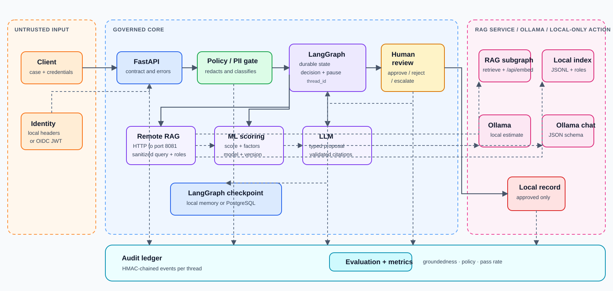

# System architecture

## Purpose and scope

The service implements a decision-support flow for insurance cases. It turns a business submission into an evidence-grounded proposal, waits for a human decision when required, and only then can send a referral to an external system.

It is not an autonomous underwriting, payment, or final-decline engine. A model recommendation is input for an authorized person; the business action is separate and protected by that approval.

## Component view

| Component | Responsibility | Primary input | Output or effect |
| --- | --- | --- | --- |
| Client | Submits a case, reads its progress, or records human review | Case JSON and credentials | API response with status, proposal, or routing result |
| FastAPI | Exposes HTTP contracts, validates models, and translates errors into safe responses | HTTP requests | Graph invocation or resume |
| Identity and authorization | Resolves the principal and checks tenant, roles, and actor consistency | Development headers or OIDC JWT | Local identity context and effective permissions |
| Policy/PII gate | Detects injection, removes known PII, and determines whether review is needed | Validated case | Sanitized case and policy result |
| Remote RAG adapter | Calls the separately running RAG service from the parent retrieve node | Sanitized narrative and roles | Typed evidence response or dependency failure |
| RAG LangGraph subgraph | Validates retrieval input and invokes hybrid retrieval in its own process | Minimized query, roles, correlation metadata | Isolated RAG state and ordered role-filtered evidence |
| Hybrid retrieval | Finds permitted context with BM25 and vector similarity | Sanitized narrative and roles | Ordered, role-filtered evidence chunks |
| Embedding service | Converts query text into vectors for the RAG service | Sanitized text | Query vector |
| Local risk estimator | Requests a non-calibrated local estimate from Ollama | Sanitized case variables | Score, factors, and explicit local provenance |
| LLM decision maker | Uses Ollama to propose accept, refer, or decline and must cite evidence | Case, score, and evidence | Validated JSON proposal |
| LangGraph workflow | Orchestrates nodes, persists state, and pauses for human input | State per `thread_id` | Final state or structured interrupt |
| Human review | Approves, rejects, or escalates a proposal | Authorized reviewer and rationale | Graph-resume signal |
| Local case recorder | Records an approved case locally without an HTTP call | Proposal and approved review | Local-only routing result |
| Audit ledger | Stores chained events and evaluation metrics | Events from each node | Verifiable evidence and operational aggregates |
| Evaluation | Applies deterministic groundedness and policy checks | Decision state | Evaluation result and metrics |

## Trust boundaries

The architecture separates five zones with different objectives:

1. **Untrusted input.** The narrative and optional fields arrive from the client. They may contain PII, hostile instructions, or incorrect business data.
2. **Governed core.** Only the sanitized object enters persisted graph state, retrieval, scoring, the LLM, and the ledger. The policy result also travels with the case so the rest of the flow knows its constraints.
3. **RAG-service boundary.** The parent sends only sanitized query text, roles,
   a bound, and correlation metadata over local HTTP. The RAG process does not
   receive parent decision state, human reviews, or routing configuration.
4. **Local model runtime.** Native Ollama embedding and chat endpoints receive only sanitized contracts. They are not treated as an authorization or security source of truth.
5. **Local approval record.** In development, approval creates a local-only routing record. No business-action boundary is crossed.

## Main data contracts

### Original submission

The submission contains case and tenant identifiers, declared actor identity, declared roles, requested action, product, narrative, and exposure. It may include an email address, phone number, and customer reference.

The API does not trust identity declared in the body: it compares `actor_id`, `tenant_id`, and the complete role set with the authenticated principal. Administrators are the controlled exception.

### Sanitized case

The gate replaces recognized email, phone, and IBAN patterns with markers such as `[EMAIL_REDACTED]`. Optional direct PII fields are excluded from the sanitized model. It also retains the number of redactions and the receipt time.

This is the only case representation stored in graph checkpoints and passed to retrieval, the Ollama estimate, the Ollama decision maker, the local recorder, and audit. The normal flow is intentionally structured to prevent accidental use of the original representation.

### Retrieved evidence

Each result includes:

- `chunk_id`, a stable reference to the indexed fragment.
- Source, title, version, and optional URL so that a reviewer can verify it.
- A text excerpt that the decision maker can use as context.
- Lexical, semantic, and hybrid scores for diagnosis.

The proposal must reference existing `chunk_id` values. If the LLM returns a citation that was not among retrieved results, the response is rejected as invalid before the flow continues.

### ML result and proposal

The local estimate declares its Ollama model name, a `local-development` version, score, factors, and calculation time. It is not a calibrated ML score. The LLM proposal carries a discrete recommendation (`accept`, `refer`, or `decline`), rationale, confidence, citations, required conditions, and an escalation reason when it refers.

Keeping score and proposal separate distinguishes a predictive signal from an explainable business recommendation. Neither replaces human approval.

## Hybrid retrieval

The parent graph's retrieve node calls a port-8081 RAG LangGraph service. That
service owns a JSONL file of knowledge chunks, each holding an embedding vector
and `allowed_roles`. For every request it:

1. Receives the sanitized query and roles through a typed HTTP contract.
2. Generates an embedding for the sanitized narrative.
3. Excludes chunks for which the actor has no permitted role.
4. Calculates a BM25 score over text and cosine similarity over vectors.
5. Normalizes the lexical signal and computes a hybrid score: `0.45 × normalized_BM25 + 0.55 × max(cosine, 0)`.
6. Returns the best five chunks by default to the parent graph.

Role filtering happens before context is built for the LLM. A prompt therefore cannot ask the model to show a document that the retriever has already excluded.

## LangGraph orchestration

The parent graph is the source of decision execution order and decision-state
persistence. Its nodes are policy, retrieval, scoring, proposal, human review,
routing or closing, and evaluation. The retrieval node is an adapter boundary:
it calls a separately compiled RAG subgraph, validates the response, then stores
the evidence in `DecisionState` and emits the parent audit event.

When it reaches human review, LangGraph emits an interrupt containing a structured request. The original HTTP call ends with status `awaiting_human`; it does not hold a connection open. A later review call resumes the same `thread_id` using `Command(resume=...)`.

The checkpointer can be:

- `memory` for local development and single-process tests. State disappears when the process restarts.
- `postgres` for durable execution and multiple processes. It requires `POSTGRES_CONNECTION_URI`.

The RAG service has a separate in-memory checkpointer and an isolated
`rag-{request_id}` thread. It is a short synchronous subgraph with no human
pause; it is intentionally not a replica of the parent decision checkpoint.
This demonstrates a distributed graph boundary without giving every node a
separate process. See the [distributed RAG component guide](components/rag-service.md).

## Side effects and their order

The graph places side effects where they can be explained and audited:

1. Receipt is audited after the case is sanitized.
2. Policy, evidence, score, and proposal are audited as they are created.
3. Human review is recorded before the following branch is selected.
4. The local recorder runs only on the `approve` branch; it makes no HTTP call in development.
5. Evaluation runs after routing or closure and feeds the metrics.

This means that a rejected or escalated proposal keeps its traceability, but does not create an external referral.

## Safe extension points

| Need | Extension point | Rule that must remain true |
| --- | --- | --- |
| Different Ollama embedding model | Configure or replace the embedding client | Reindex and receive only sanitized text |
| New index or vector store | Replace `HybridRetriever` behind the RAG-service contract while retaining pre-retrieval role filtering | Never retrieve documents unauthorized for the actor |
| Calibrated scoring model | Implement a client that returns `RiskScore` | Declare model and version; keep local estimates out of production |
| Additional policy | Extend gate rules and their reasons | Apply it before persistence or any integration call |
| External action | Create an explicit non-development router after human review | Never cross into an action from a non-approved branch |
| Additional evaluation | Add deterministic rules to evaluation | Keep evidence, version, and result auditable |

## What the system does not do

- It does not use the LLM response to grant permissions.
- It does not send original PII to Ollama in the standard flow.
- It does not execute a business action from an automatic recommendation.
- It does not present its local Ollama estimate as a calibrated production score.
- It does not use audit as authorization: audit proves what happened; identity and policy decide what is allowed.
