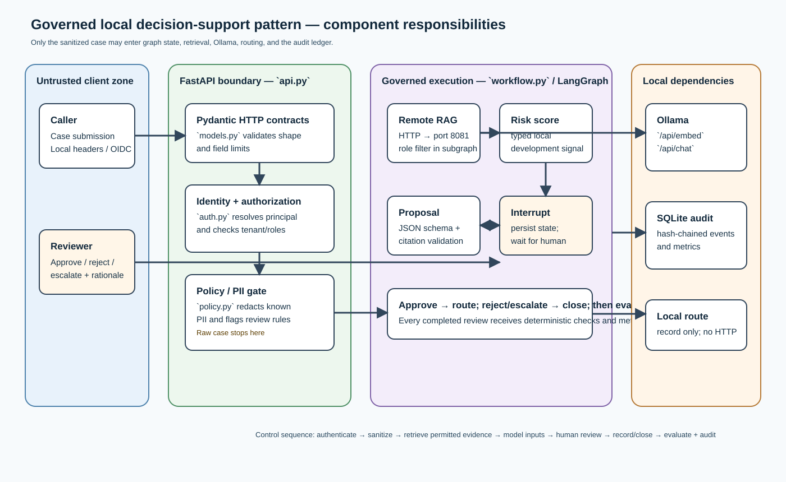

# Component reference atlas

This is the file-level reference for the learning implementation. It explains
what each component owns, the data it is permitted to handle, the technology it
uses, and the point at which it runs. It is intentionally descriptive: use it
to understand the implementation before opening source files.

## The one-sentence design

The decision service accepts an insurance case, removes direct PII, asks a
separate RAG LangGraph service for role-permitted policy evidence, asks locally
hosted Ollama models for a score and proposal, stops in LangGraph for a human
decision, and then records a local outcome plus an auditable evaluation.

## How to read this reference

Start with [api.py](api.md) and [workflow.py](workflow.md) for the request
journey and the LangGraph pause. Then read [rag/service.py](rag-service.md) to
see the one intentionally distributed subgraph. Continue with the data and
boundary documents: [models.py](models.md), [auth.py](auth.md), [policy.py](policy.md),
and [retrieval.py](retrieval.md). The remaining pages explain integrations,
persistence, operations, and tests.

## Source layout

`src/ai_architect/` contains only importable application code, grouped by
feature. Standalone maintenance tools are intentionally outside it:

~~~text
src/ai_architect/
├── decision/       port-8080 API, policy/PII gate, LangGraph workflow, evaluation
├── rag/            port-8081 RAG service and hybrid retrieval implementation
├── integrations/   Ollama, remote-RAG, and case-routing adapters
├── governance/     identity/authorization and tamper-evident audit ledger
└── shared/         typed contracts and runtime configuration
scripts/            offline RAG-index construction tool
sanity_build/       executable HTTP verification, outside the application package
~~~

This prevents request-serving code from being mixed with an offline index build
or a local verification client.

## File map

| File | Responsibility | Runtime role | Detailed reference |
| --- | --- | --- | --- |
| `src/ai_architect/decision/api.py` | HTTP application, lifecycle, error translation | Entry point for port 8080 | [api.py](api.md) |
| `src/ai_architect/__init__.py` | Package identity and short service description | Package import metadata | [project files](project-files.md) |
| `src/ai_architect/shared/models.py` | Validated business and HTTP contracts | Every boundary | [models.py](models.md) |
| `src/ai_architect/governance/auth.py` | Development identity, OIDC verification, authorization | Before protected API operations | [auth.py](auth.md) |
| `src/ai_architect/shared/config.py` | Environment-derived settings and deployment guardrails | Application startup | [config.py](config.md) |
| `src/ai_architect/decision/policy.py` | PII redaction, injection detection, review rules | Before graph state and model calls | [policy.py](policy.md) |
| `scripts/build_rag_index.py` | Knowledge-file chunking and index generation | Offline command | [index builder](index-builder.md) |
| `src/ai_architect/rag/service.py` | Independently running RAG API and LangGraph subgraph | Entry point for port 8081 | [rag-service.py](rag-service.md) |
| `src/ai_architect/rag/retrieval.py` | Role-filtered BM25 and vector retrieval | RAG subgraph retrieval node | [retrieval.py](retrieval.md) |
| `src/ai_architect/integrations/clients.py` | Native Ollama, remote-RAG, and routing adapters | Graph integration/action boundaries | [clients.py](clients.md) |
| `src/ai_architect/decision/workflow.py` | LangGraph state, nodes, branches, and human interrupt | Decision orchestration | [workflow.py](workflow.md) |
| `src/ai_architect/governance/audit.py` | Hash-chained audit events and metric storage | Side effects throughout workflow | [audit.py](audit.md) |
| `src/ai_architect/decision/evaluation.py` | Deterministic proposal-quality checks | Final graph node | [evaluation.py](evaluation.md) |
| `sanity_build/smoke.py` | Real HTTP learning-mode verification | Developer command | [smoke.py](smoke.md) |
| `tests/` | Deterministic behavioral tests and named test doubles | Test time only | [test suite](test-suite.md) |
| Root files and `data/` | Packaging, setup, sample knowledge, document navigation | Setup and learning material | [project files](project-files.md) |

## Important terminology

| Term | Meaning in this project | What it is not |
| --- | --- | --- |
| Case | An incoming insurance decision-support request | A full customer record or policy administration record |
| Thread | LangGraph execution/checkpoint identifier | A user session or tenant identifier |
| Proposal | Evidence-cited model recommendation | An approved business action |
| Review | Authorized person's approve, reject, or escalate input | A background LLM decision |
| Route | The post-approval handoff abstraction | An automatic bind, payment, or claim settlement |
| Local score | Ollama structured estimate marked `local-development` | A calibrated production ML score |
| Hybrid RAG | BM25 plus cosine similarity after role filtering | A permission system implemented by a prompt |

## What uses LangChain and LangGraph

There is **no LangChain dependency or LangChain chain in this repository**.
The project uses **LangGraph directly** in two places: `decision/workflow.py` compiles
the durable parent decision graph, and `rag/service.py` compiles the isolated
RAG subgraph. `decision/api.py` invokes/resumes the parent graph; the port-8081 service
invokes the RAG graph. The optional PostgreSQL checkpoint dependency applies to
the parent decision graph.

The Ollama calls are direct native HTTP calls in `integrations/clients.py`; they do not go
through an OpenAI-compatible API or a LangChain wrapper. This deliberately keeps
the learning pattern visible: models produce typed inputs to a governed workflow,
not permissions or final actions.

## Non-negotiable boundaries in the current implementation

1. `CaseSubmission` is accepted only at the API edge; downstream code works with
   `SanitizedSubmission`.
2. The parent sends only sanitized query text and roles to the RAG service; its
   retrieval subgraph filters document access by role before evidence reaches Ollama.
3. Ollama JSON is parsed and validated with Pydantic contracts.
4. LangGraph always interrupts for a human review before routing.
5. Development approval uses `LocalCaseRouter`; it makes no outbound request.
6. Audit events are chained within each thread and evaluation produces metrics.

## A practical learning path

1. Start the RAG service, then the decision API, and run `python3 sanity_build/smoke.py`.
2. Open the pretty JSON under `manual_review_response`.
3. Read [workflow.py](workflow.md) while following that response through the
   lifecycle diagram.
4. Read [rag/service.py](rag-service.md), [policy.py](policy.md), and
   [rag/retrieval.py](retrieval.md) to understand why the model sees only sanitized,
   permitted context.
5. Read [governance/audit.py](audit.md) and query the audit endpoint using the smoke-test
   thread ID.

The broader design guides remain available in the parent [documentation
index](../README.md).
