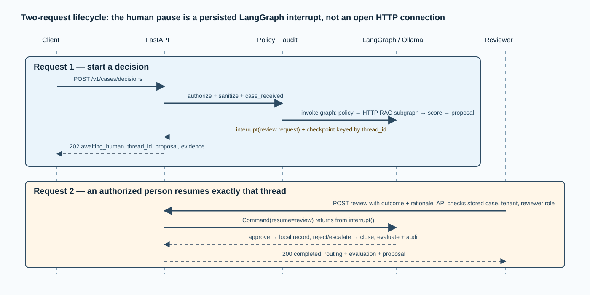

# `api.py` — HTTP entry point and LangGraph host

## Why this file exists

`src/ai_architect/decision/api.py` is the composition root. It turns configuration into a
running FastAPI application, creates the implementation objects used by the
graph, selects identity and persistence implementations, and exposes the public
HTTP endpoints. It does not contain insurance policy logic or prompt logic;
those responsibilities are delegated to dedicated components.

## Technology and responsibility

| Concern | Implementation | Why it matters here |
| --- | --- | --- |
| HTTP framework | FastAPI | Validates request models, exposes OpenAPI at `/docs`, and returns typed responses |
| Process server | Uvicorn | Runs the application on `127.0.0.1:8080` through the `ai-architect` command |
| Durable orchestration | LangGraph compiled graph | Runs nodes in order and resumes a paused decision by thread ID |
| Local persistence | LangGraph `InMemorySaver` plus SQLite audit ledger | Makes the tutorial work with no infrastructure beyond Ollama |
| Production option | LangGraph PostgreSQL checkpointer | Makes graph state durable when explicitly configured |

## Startup composition

At startup, `create_app()` performs configuration checks, then its FastAPI
lifespan builds or receives four dependencies:

1. **Workflow services.** `build_services()` constructs the policy gate,
   `RemoteRagRetriever`, Ollama score/proposal clients, router, evaluator, and
   audit ledger. The JSONL index and query-embedding client belong exclusively
   to the separate RAG process; the parent calls it through `RAG_SERVICE_URL`.
2. **Identity verifier.** Development uses the local header resolver. Staging and
   production select OIDC JWT verification.
3. **LangGraph checkpointer.** `memory` selects `InMemorySaver`; `postgres`
   selects the optional PostgreSQL saver and runs its schema setup.
4. **Compiled graph.** `build_decision_graph()` receives those services and the
   selected checkpointer exactly once for the app lifespan.

Dependency injection parameters let tests supply deterministic services and an
in-memory checkpointer. That is why tests can exercise the whole API without an
Ollama server or a real case-management service.

## Endpoint contract and behavior

| Endpoint | Who may call it | What it does | Main outcomes |
| --- | --- | --- | --- |
| `GET /health` | Anyone who can reach local port 8080 | Reports process liveness and configured environment | `200` |
| `POST /v1/cases/decisions` | Principal matching the submitted actor, tenant, and roles; admin exception | Sanitizes, audits receipt, and invokes graph until end or review interrupt | `202` with `awaiting_human`, or `blocked`/error |
| `POST /v1/cases/{case_id}/decisions/{thread_id}/review` | Case tenant; approval needs an approving role | Checks stored case ownership, resumes same graph with review | `200` completed with routing and evaluation |
| `GET /v1/audit/{thread_id}` | Same tenant or admin | Reads the audit trace only after verifying ownership from graph state | `200` ordered events |
| `GET /v1/metrics` | `ai_admin` only | Reads aggregate evaluation measurements | `200` averages and sample counts |

The start endpoint returns `202 Accepted` because a decision has been accepted
and persisted but may be intentionally paused for review. The review endpoint
returns `200` because it completes the existing thread synchronously in the
local pattern.

## The start decision sequence

1. FastAPI validates the payload against `StartDecisionRequest`.
2. The identity verifier resolves a `Principal` from headers in development or
   a verified bearer token outside development.
3. Authorization compares the principal with the actor, tenant, and full role
   set declared in the request body.
4. `PolicyGate.sanitize()` creates the safe representation. The original request
   object is not passed to graph state, Ollama, or the audit ledger.
5. The file writes the `case_received` audit event using that sanitized object.
6. The compiled graph is invoked with a new or client-provided `thread_id`.
7. `_to_response()` converts normal graph state or a LangGraph interrupt into a
   `DecisionResponse` for the caller.

## The review sequence

Before resuming, the endpoint reads the graph snapshot. This is a deliberate
integrity check: it proves that the thread exists and that its stored case ID
matches the URL path. It then authorizes the caller against the *stored
sanitized submission*, not a client-supplied case copy.

Only after those checks does the endpoint send `Command(resume=review)` to
LangGraph. The graph returns from `interrupt()`, persists the review, branches
to route or close, runs evaluation, and returns final state. A caller cannot
resume a different case simply by changing a URL parameter.

## Error mapping

| Source | HTTP response | Meaning for a client |
| --- | --- | --- |
| Missing/invalid identity | `401` | Credentials or local identity headers are absent/invalid |
| Identity, tenant, or role failure | `403` | Authenticated identity is not allowed to perform that operation |
| Unknown thread | `404` | No stored graph execution exists |
| Case/thread mismatch | `409` | The thread belongs to another case ID |
| Missing model/index/router integration | `503` | Do not fabricate a decision; repair dependency/configuration |
| RAG service, Ollama, or external HTTP failure | `502` | Required provider did not complete the call |
| Invalid provider/model output or invalid business data | `422` | The typed contract or workflow invariant failed |

## Local-only behavior and production seam

In `development`, `build_services()` always selects `LocalCaseRouter`; an
approved decision ends as `routing.status = recorded` and
`destination = local-only`. Even if stale routing variables remain in a local
`.env`, they do not cause an external call.

Outside development, a real `HttpCaseRouter` is chosen only when both the
routing URL and routing API key are explicitly configured. Otherwise the graph
uses `UnavailableCaseRouter` and fails visibly. This makes an unconfigured
production action safer than a falsely successful handoff.

## What this file intentionally does not decide

- It does not inspect PII patterns or underwriting policy; `policy.py` does.
- It does not calculate RAG ranks or open the index; the independently started
  `rag/service.py` process and `rag/retrieval.py` do.
- It does not decide whether an approval should route; `workflow.py` does.
- It does not write SQL directly; `audit.py` does.
- It does not trust model output or request-body identity without validation.

## How to validate this component

Start `ai-architect-rag` first and verify port `8081`, then start
`ai-architect`, visit `http://127.0.0.1:8080/docs` for the generated contract,
and run `python3 sanity_build/smoke.py`. The smoke result should contain
`initial_decision.status = awaiting_human` and a completed
`manual_review_response`.
