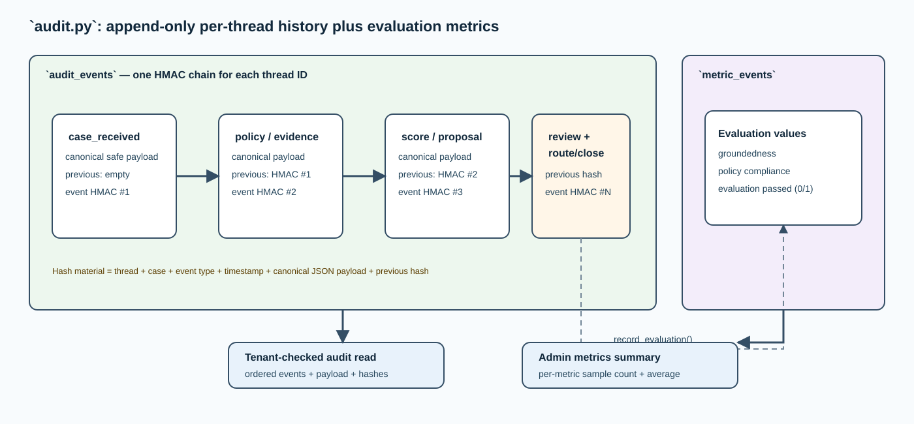

# `audit.py` — tamper-evident decision history and metrics

## Purpose

`src/ai_architect/governance/audit.py` provides two durable records: an append-only event
ledger for each LangGraph thread and a small metrics ledger for evaluation
measurements. It uses SQLite locally and can use PostgreSQL when configured. It
is not an authorization store and it is not a customer case-management system;
it records what the decision-support flow did.

## Storage model

| Table | One row represents | Key fields | Primary reader |
| --- | --- | --- |
| `audit_events` | One material lifecycle event | Sequence, event ID, UTC time, thread/case ID, event type, canonical payload, previous/event hashes | Per-thread audit endpoint |
| `metric_events` | One numeric observation | Metric ID, UTC time, thread/case ID, metric name/value | Admin metrics endpoint |

SQLite uses immediate transactions and a re-entrant process lock; PostgreSQL uses
the same logical statements with its parameter form. Schema creation and indexes
are performed when the ledger is constructed so a local empty database can be
used immediately.

## Hash-chain mechanism

For each new `audit_events` row, the ledger canonicalizes the payload as
sorted-key compact JSON and builds a string from thread ID, case ID, event type,
timestamp, canonical payload, and the preceding hash for that thread. It computes
an HMAC-SHA-256 using `AUDIT_HMAC_KEY` and stores both the old and new hashes.

Each thread has its own chain. Reordering, replacing, or deleting an event breaks
the relationship that a verifier with the key could recompute. This makes the
ledger **tamper-evident**, not immutable against someone who controls the
database and secret. Production-grade retention, key management, backup, and
independent verification remain separate concerns.

## PII safeguard

Before writing an event, `append()` rejects a payload with top-level
`applicant_email` or `applicant_phone` keys. This is a lightweight defense in
depth check. The primary control is earlier: only `SanitizedSubmission` is used
in the normal graph path. Nested or unknown PII types are not fully detected by
this check, which is why policy data minimization must remain first.

## Event timeline produced by the workflow

| Event | Meaning |
| --- | --- |
| `case_received` | Safe submission entered the workflow |
| `policy_evaluated` | Deterministic policy/PII result was created |
| `evidence_retrieved` | Authorized chunk IDs/sources were selected |
| `ml_score_received` | Local Ollama score and factors were produced |
| `decision_proposed` | Structured evidence-cited proposal was created |
| `human_review_recorded` | Reviewer outcome and rationale were received |
| `case_recorded_locally` / `case_routed` | Approved branch reached local or external route boundary |
| `case_rejected` / `case_escalated` | Non-approved closure branch completed |
| `decision_evaluated` | Final deterministic quality result was stored |

The graph calls audit as each material step completes. An investigation can
therefore identify the last completed stage rather than seeing only a final
status.

## Metrics

`record_evaluation()` stores three individual values: `groundedness`,
`policy_compliance`, and `evaluation_passed` (one or zero). `metrics_summary()`
groups by name and returns sample count and average. The result is intentionally
small and useful for local learning; it is not a complete observability platform.

Only an `ai_admin` principal can use the metrics endpoint. Audit reads are
tenant-checked in `api.py` before this file receives a thread query.

## Failure behavior

The ledger requires a 24+ character HMAC key and a supported connection URL at
construction. SQL failures roll back the active transaction and propagate; the
workflow/API does not report a successful governed decision when its audit side
effect cannot complete.

## How to inspect it locally

Run the smoke test, copy its `thread_id`, and request
`GET /v1/audit/{thread_id}` with matching development tenant headers. The API
returns events in sequence order, including canonical payloads and both hashes.
This is the most direct way to see the full history without reading database
tables manually.
