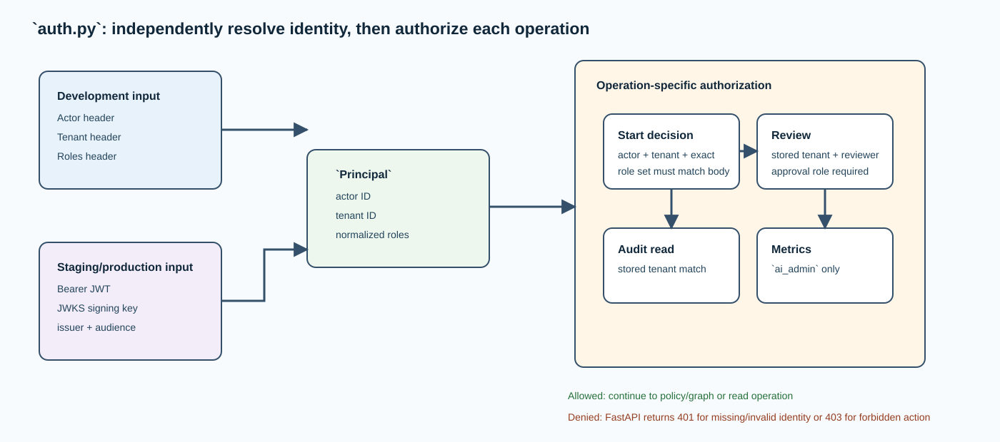

# `auth.py` — identity resolution and decision authorization

## Purpose

`src/ai_architect/governance/auth.py` separates **who called** from **what they asked the
service to do**. It resolves a small `Principal` containing actor ID, tenant ID,
and normalized roles, then checks that this principal is allowed to submit,
review, read audit data, or read metrics.

The design matters because identity in a JSON body is only a claim. The API uses
it as an authorization target only after comparing it with a principal obtained
from headers in local mode or a verified OIDC token outside local mode.

## Identity modes

| Environment | Verifier | Credential source | Intended use |
| --- | --- | --- | --- |
| `development` | `DevelopmentIdentityVerifier` | Three `X-Development-*` headers | Local learning on loopback only |
| `staging` / `production` | `OidcJwtVerifier` | `Authorization: Bearer …` JWT | Authenticated deployment |

Development headers require actor ID, tenant ID, and at least one role. They are
not a security perimeter: any local process that can reach the service can
choose them. The documentation and API bind the learning server to `127.0.0.1`;
never expose this mode to a network.

The OIDC verifier discovers a signing key through JWKS and validates issuer,
audience, and allowed asymmetric algorithms (`RS256` or `ES256`). It maps token
claims `sub`, `tenant_id`, and a list-valued `roles` claim into the same
`Principal` used locally. Invalid/missing claims fail closed.

## Authorization rules

| Operation | Rule | Reason |
| --- | --- | --- |
| Start a decision | Principal actor and tenant must equal the submission; exact normalized role set must match | Prevents a caller from submitting on behalf of another person or elevating roles in the body |
| Resume/review | Principal tenant must match stored sanitized submission; reviewer ID must match principal | Prevents cross-tenant review and reviewer impersonation |
| Approve | Reviewer must additionally hold `underwriter`, `claims_adjuster`, or `ai_admin` | Limits the one branch that records an approved outcome |
| Read audit | Principal tenant must match stored state | Prevents thread ID from becoming an audit-discovery capability |
| Read metrics | Principal needs `ai_admin` | Keeps aggregate operational data administratively scoped |
| Administrator | `ai_admin` bypasses identity/tenant body matching checks where explicitly coded | Supports controlled administrative access; it is not a model-granted privilege |

Roles are lower-cased when parsed. This makes `Underwriter` and `underwriter`
equivalent but does not make a caller with a subset or a superset of submitted
roles equivalent for submission authorization.

## Failure behavior

Authentication failures are raised as `AuthenticationError`. `api.py` maps
failure to `401` when a principal cannot be established and to `403` when an
established principal is not permitted to perform the action. The distinction
helps clients repair credentials versus repair their requested operation.

## Security boundary that remains outside this file

This file does not redact PII, inspect prompt injection, decide underwriting
policy, or trust a model's recommendation. It creates the human identity context
that those other controls use. In particular, the LLM never receives a chance to
select a role or authorize itself.

## Local request headers

For the tutorial, every protected request needs the following headers:

| Header | Example role | Used for |
| --- | --- | --- |
| `X-Development-Actor-ID` | `underwriter-demo` | User identity and review ownership |
| `X-Development-Tenant-ID` | `tenant-local` | Tenant isolation |
| `X-Development-Roles` | `underwriter` | Submission, approval, retrieval, and metrics checks |

There is no local development API key in the current pattern. That is a
deliberate convenience for a localhost tutorial, not a production design.

## Validation focus

`tests/test_api.py` proves that mismatched body identity is rejected and that
metrics require an admin role. The start/review API tests also demonstrate that a
review can be performed by a different underwriter, provided the reviewer ID
matches that reviewer’s authenticated local identity.
