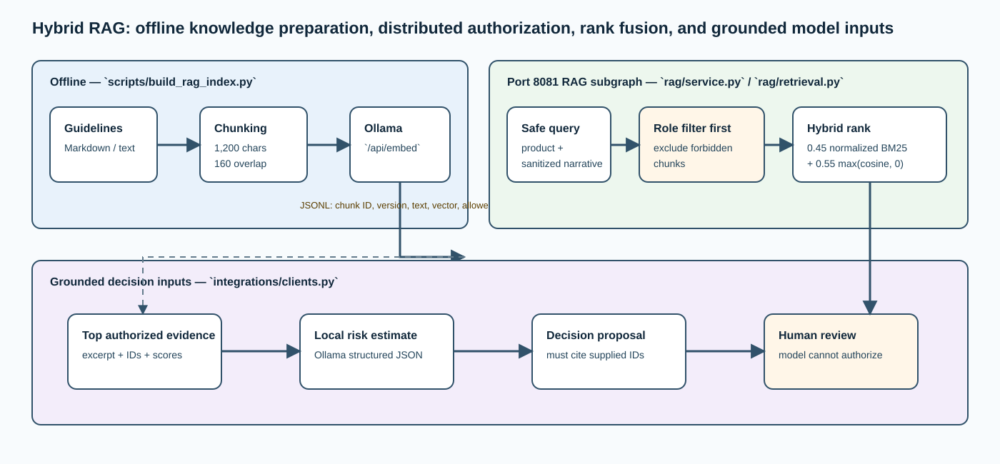

# `clients.py` — typed Ollama and routing adapters

## Purpose

`src/ai_architect/integrations/clients.py` isolates every dependency that the workflow calls:
remote retrieval, embeddings, risk estimation, decision proposal, and case
routing. The workflow depends on small Python protocols, while this file
supplies the local Ollama, RAG-service, and local-routing implementations. This
separation makes it clear which parts are replaceable integrations and lets tests
use named test doubles only under `tests/`.

## Interface boundary

| Contract | Input | Output | Explicit implementations |
| --- | --- | --- | --- |
| `EmbeddingClient` | Sanitized text | Numeric vector | `OllamaEmbeddingClient`, `UnavailableEmbeddingClient` |
| `EvidenceRetriever` | Sanitized query, roles, bound, correlation | Typed ranked evidence | `RemoteRagRetriever`, `HybridRetriever`, `UnavailableRetriever` |
| `RiskScorer` | `SanitizedSubmission` | `RiskScore` | `OllamaRiskScorer`, `UnavailableRiskScorer` |
| `DecisionMaker` | Safe case, score, typed evidence | `DecisionProposal` | `OllamaDecisionMaker`, `UnavailableDecisionMaker` |
| `CaseRouter` | Safe case, proposal, human review | `RoutingResult` | `LocalCaseRouter`, `HttpCaseRouter`, `UnavailableCaseRouter` |

Every production adapter now directly inherits its protocol. IDE class hierarchy,
"go to base", and "find implementations" views therefore show the concrete
relationship instead of relying only on Python's structural typing. The protocols
still keep test doubles lightweight and test-only.

The contracts make a replacement explicit. For example, a calibrated risk model
can implement `RiskScorer`, but it must return the same provenance-bearing
`RiskScore`; it cannot return an undocumented dictionary that silently changes
the workflow.

`EvidenceRetriever` is the navigation contract for both the local hybrid engine
and the distributed adapter. `HybridRetriever` implements it inside the RAG
service; `RemoteRagRetriever` implements it in the parent service. That means
the parent graph calls one clear capability while its actual implementation is
visible in an IDE hierarchy rather than hidden behind an untyped function.

## Distributed RAG adapter

`RemoteRagRetriever` is selected by `api.py` for the parent decision graph. It
creates a `RagRetrievalRequest`, sends it to
`{RAG_SERVICE_URL}/v1/rag/retrieve`, validates the `RagRetrievalResponse`, and
returns the typed evidence list. Its `correlation_id` is the parent decision
thread ID; the RAG service creates a separate request-specific graph thread.

The adapter sends only sanitized query content, authorized roles, a bounded
result limit, and trace metadata. It does not serialize `DecisionState` or
provide the RAG service with human reviews, audit access, routing secrets, or
original PII. See [rag/service.py](rag-service.md) for the remote subgraph and
its exact API contract.

## Native Ollama calls

| Adapter | Ollama endpoint | Structured result | Local safety property |
| --- | --- | --- | --- |
| `OllamaEmbeddingClient` | `POST /api/embed` | First vector in `embeddings` | Only caller-supplied safe text enters |
| `OllamaRiskScorer` | `POST /api/chat` | `LocalRiskEstimate`: score plus factors | Marks output as `local-development`, temperature zero |
| `OllamaDecisionMaker` | `POST /api/chat` | `DecisionProposal` | Requires schema output and citations from supplied evidence |

These are native Ollama endpoints, not OpenAI-compatible endpoints and not
LangChain wrappers. `httpx` performs synchronous calls with the configured
timeout. A non-success response surfaces to `api.py` as a dependency failure.

## Local risk estimate

The risk scorer asks Ollama for JSON matching a narrow schema: a number from 0
to 1 and at most ten textual factors. It passes deterministic generation options
and states in its system instruction that the estimate is not calibrated and
cannot authorize an action. The adapter returns model name
`ollama/<configured-model>` and version `local-development` so that downstream
audits cannot be mistaken for a registered production ML artifact.

This output is a learning stand-in for the “existing ML scoring” stage in the
architecture. It provides a typed signal to demonstrate placement and
provenance; it is not suitable for underwriting calibration, fairness, or
business delegation.

## Proposal generation

The decision maker passes three typed objects to Ollama: the sanitized case,
local score, and retrieved evidence. Its system instruction says that data is
untrusted, the assistant cannot bind/pay/execute actions, only JSON is valid,
and only supplied chunk IDs may be cited.

After receiving `message.content`, the adapter parses it as `DecisionProposal`.
It then independently computes the difference between proposal citations and
the retrieved IDs. Any invented citation is a validation failure. This is the
important distinction between telling a model to be grounded and verifying
grounding mechanically.

## Routing implementations

| Implementation | When selected | Effect |
| --- | --- | --- |
| `LocalCaseRouter` | Always in `development` | Returns `recorded` / `local-only`; makes no HTTP request |
| `HttpCaseRouter` | Non-development with URL and API key | Posts safe case ID, tenant, proposal, and human review; returns `routed` |
| `UnavailableCaseRouter` | Routing is required but not configured | Raises an explicit integration-unavailable failure |

The real HTTP router is a future integration seam, not active local behavior. It
uses an API key only for that outbound case-management provider; it is unrelated
to local API access, which deliberately has no development API key.

## Defensive parsing and unavailable adapters

Helpers reject unexpected Ollama envelope types, missing `message.content`,
empty vectors, and invalid vector values. The `Unavailable*` implementations
are fail-closed placeholders: they raise clear errors instead of returning fake
scores, evidence, decisions, or routing success. The API maps them to `503`.

## What is not delegated to Ollama

Ollama does not authenticate users, decide document access, redact PII, choose a
workflow branch, authorize a review, write audit history, or execute an action.
It produces two validated inputs into a process that remains controlled by the
application and an authorized human.

## Validation evidence

`tests/test_ollama_clients.py` verifies the exact native endpoint and payload
shape for embeddings, checks the local score label/schema, validates a structured
proposal, checks the parent-to-RAG HTTP payload, and confirms that
`LocalCaseRouter` never needs external HTTP.
