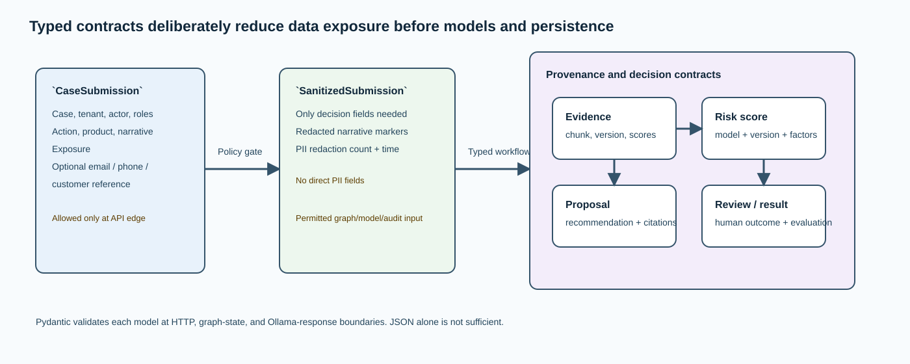

# `models.py` — contracts that make every boundary explicit

## Why this file exists

`src/ai_architect/shared/models.py` is the shared vocabulary of the system. It uses
Pydantic v2 models to define what can enter through HTTP, what may cross the PII
boundary, what an Ollama response must look like, and what the API can return.
It prevents the same business object from silently changing shape between the
client, the graph, models, audit, and reviewer.

## Contract layers

| Layer | Models | Purpose |
| --- | --- | --- |
| Public input | `CaseSubmission`, `StartDecisionRequest`, `ReviewDecisionRequest` | Strictly validate untrusted HTTP payloads |
| Safe internal input | `SanitizedSubmission` | The only case representation allowed into state, RAG, Ollama, and audit |
| RAG service boundary | `RagRetrievalRequest`, `RagRetrievalResponse` | Minimized request and typed evidence response between port 8080 and port 8081 |
| Governance | `PolicyResult`, `HumanReview`, `HumanReviewRequest`, `RoutingResult` | Carry policy, human authority, and post-review outcome |
| Model and evidence | `RetrievedEvidence`, `RiskScore`, `DecisionProposal` | Make retrieval/model provenance inspectable and validate outputs |
| Measurement and output | `EvaluationResult`, `DecisionResponse` | Return a typed state summary and monitor quality |

## Input boundary: `CaseSubmission`

This is deliberately the richest case model and is accepted only at the API
edge. It requires bounded case, tenant, actor, product, narrative, and exposure
fields. It also holds optional direct PII fields: email, phone, and customer
reference. The existence of those fields here does **not** authorize their
storage later.

The model normalizes actor roles by trimming, lower-casing, de-duplicating, and
sorting them. Authorization can therefore compare the body roles with the
authenticated principal deterministically rather than relying on presentation
differences such as uppercase or order.

## The data-minimization transition: `SanitizedSubmission`

`SanitizedSubmission` has no email, phone, or customer-reference fields. It
keeps only the decision data needed downstream plus `pii_redactions` and a UTC
receipt time. This type distinction is central to the architecture: a function
that expects the safe type cannot accidentally receive optional direct PII
without a deliberate conversion.

## Evidence and model provenance

`RetrievedEvidence` binds a visible excerpt to a stable `chunk_id`, source,
title, index version, optional URL, and all three scores. `RiskScore` declares
the producing model name/version, numeric value, factors, and timestamp.
`DecisionProposal` limits the recommendation to `accept`, `refer`, or
`decline`, requires a meaningful rationale and one or more citations, and
permits explicit conditions and an escalation reason.

The combination means a reviewer can ask three concrete questions: which
knowledge fragment was used, which model supplied the score, and which evidence
IDs the proposal claims support it.

## Distributed RAG contracts

`RagRetrievalRequest` is the separate-service contract, not a copy of
`DecisionState`. It permits only a bounded query, normalized caller roles,
bounded `top_k`, a parent `correlation_id`, and a generated `request_id`. The
parent creates it only after PII sanitization. The RAG process returns
`RagRetrievalResponse`: the same correlation ID, its own `rag_thread_id`, and
validated `RetrievedEvidence` records.

The two IDs serve different purposes. `correlation_id` links observability to
the parent decision thread; `request_id` creates a non-colliding RAG subgraph
checkpoint. Neither is authorization, and neither lets the RAG service retrieve
the parent state. See [rag/service.py](rag-service.md) for the complete flow.

## Human and workflow contracts

`HumanReviewRequest` is the payload emitted at the LangGraph interrupt. It
contains the case identity, requested action, proposal, score, and retrieved
evidence needed to make an informed review. `HumanReview` captures one
reviewer, one constrained outcome (`approve`, `reject`, or `escalate`), a
rationale, and a UTC timestamp.

`RoutingResult` separates the status from the destination. The local tutorial
returns `recorded` and `local-only`; a configured non-development integration
can return `routed` and an external reference. Rejection/escalation are still
routing-shaped terminal outcomes so the final API response has a uniform shape.

## Response shape and presence rules

`DecisionResponse` has one `thread_id` and status plus optional sections. Their
presence explains where an execution stopped:

| Status | Normally present | Normally absent |
| --- | --- | --- |
| `awaiting_human` | policy, proposal, review request | routing, evaluation |
| `completed` after approval | policy, proposal, routing, evaluation | review request |
| `completed` after rejection/escalation | policy, proposal, closure routing, evaluation | review request |
| `blocked` | policy | evidence-derived proposal, review, routing, evaluation |
| `failed` | error when returned by a future graph path | Success artifacts |

## Validation is a control, not formatting

Pydantic validation runs at every important boundary: FastAPI parses incoming
requests, the workflow rebuilds typed values from persisted dictionaries, and
Ollama structured text is parsed as a defined schema. A malformed model answer,
an invented enum value, a score outside `[0, 1]`, or a citation-less proposal is
rejected rather than accepted because it is syntactically JSON.

## What to change when the domain expands

Add fields in the narrowest layer possible. For example, add a confidential
input field to `CaseSubmission` only if the policy gate explicitly decides how
to remove or transform it before creating `SanitizedSubmission`. Adding it to
the sanitized model first would make it eligible for every downstream boundary.

When adding a decision option, update the enum, authorization rules, workflow
branching, API documentation, evaluation, and tests together. The enums make
such changes discoverable rather than hidden in free text.
