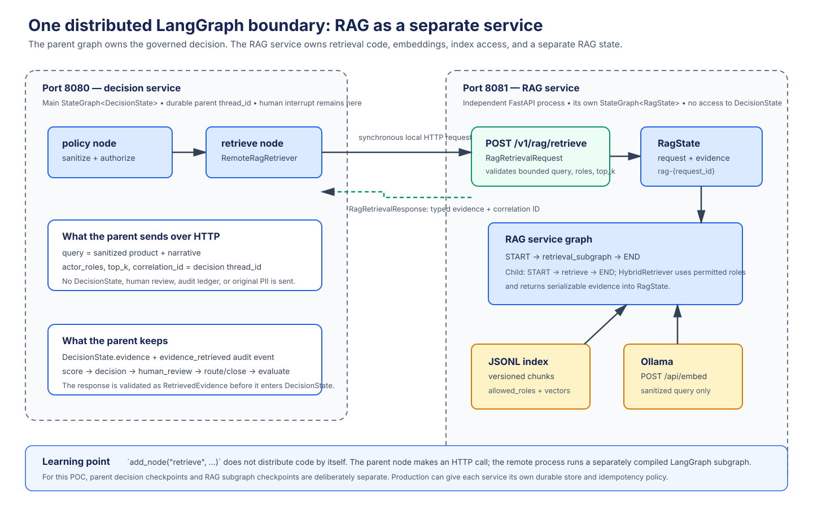

# `rag/service.py` — separate RAG API and LangGraph subgraph



## Purpose

`src/ai_architect/rag/service.py` is the one intentionally distributed part of
the learning architecture. It starts a separate FastAPI process on port `8081`,
owns the local knowledge index and Ollama embedding client, and compiles a small
LangGraph subgraph for retrieval. The main decision process on port `8080` calls
it through a narrow HTTP contract.

This separation is educational and deliberate. It demonstrates that a LangGraph
node can delegate work to a separately deployed graph without making every node
a network service. The decision workflow remains one coherent graph with its
human pause, audit history, and final routing boundary in the parent process.

## Runtime ownership

| Process | Port | Owns | Does not own |
| --- | --- | --- | --- |
| Decision service | `8080` | `DecisionState`, policy, risk score, proposal, human review, audit, route/close/evaluate | JSONL index, Ollama embeddings, RAG subgraph state |
| RAG service | `8081` | `RagState`, hybrid retriever, index file, Ollama embedding client | parent decision state, review outcome, audit ledger, routing |
| Ollama | `11434` by default | `POST /api/embed`, plus the score/proposal chats used by the parent | authorization, routing, graph state |

Keeping that ownership strict makes the boundary easy to reason about. The RAG
service cannot approve a case because it never receives the proposal or review;
the parent cannot bypass the retrieval controls because it receives evidence
only through the typed service response.

## The RAG subgraph

`build_rag_subgraph()` creates the RAG service graph with this topology:

```text
START → retrieval_subgraph → END
```

`retrieval_subgraph` is itself a compiled `StateGraph[RagState]` created by
`build_retrieval_subgraph()`:

```text
START → retrieve → END
```

`RagState` has only two serializable fields:

| Field | Written by | Meaning |
| --- | --- | --- |
| `request` | HTTP endpoint | Validated query, roles, limit, parent correlation ID, and RAG request ID |
| `evidence` | `retrieve` node | Serialized `RetrievedEvidence` records returned by hybrid ranking |

The outer graph shows LangGraph composition explicitly: a compiled graph is
registered as its `retrieval_subgraph` node. Inside that child graph, the
`retrieve` node reconstructs `RagRetrievalRequest` from state, invokes the
`EvidenceRetriever` contract, and writes only validated evidence back to
`RagState`. It has no conditional decision and no human interrupt because
retrieval is a bounded synchronous capability. A more complex retrieval system
could add nodes such as query rewriting, separate lexical/vector sources, or
quality filtering while preserving the same external request/response contract.

The service creates its own `InMemorySaver`. Its `rag_thread_id` is
`rag-{request_id}`, so it cannot collide with a parent decision thread. This is
an ephemeral execution trace for the local tutorial; it does not persist across
RAG-service restarts and it is not used to resume a human decision. The parent
graph is the durable workflow boundary and can independently use its configured
memory or PostgreSQL checkpointer.

## HTTP boundary

### Request: `POST /v1/rag/retrieve`

The parent uses `RemoteRagRetriever` in `clients.py` to send a
`RagRetrievalRequest`:

| Field | Why it crosses the boundary |
| --- | --- |
| `query` | Sanitized product plus sanitized narrative supplies retrieval relevance |
| `actor_roles` | Enables pre-retrieval authorization against indexed `allowed_roles` |
| `top_k` | Bounds the returned context; defaults to five and is capped at ten |
| `correlation_id` | The parent `DecisionState.thread_id`, used for tracing only |
| `request_id` | A newly generated UUID used to create an isolated RAG graph thread |

The endpoint validates all fields with Pydantic before the subgraph runs. The
request does **not** contain the complete `DecisionState`, source submission,
original PII fields, proposal, review, audit secret, or routing configuration.

### Response: `RagRetrievalResponse`

The service returns the original `correlation_id`, its own `rag_thread_id`, and
an ordered list of `RetrievedEvidence`. Each evidence item has the source,
version, bounded excerpt, role-filtered ranking scores, and stable `chunk_id`.
`RemoteRagRetriever` validates the response before returning it to the parent
node. The parent then writes evidence into `DecisionState` and emits its own
`evidence_retrieved` audit event.

The response intentionally does not alter parent state remotely. The HTTP call
is data exchange; the `retrieve` node in `workflow.py` remains the only parent
node allowed to merge evidence into the decision execution.

## How one parent node calls another graph

The parent topology still contains `policy → retrieve → score`. Its `retrieve`
node calls `services.retriever.retrieve(...)`. In local distributed mode that
implementation is `RemoteRagRetriever`, which performs:

```text
parent retrieve node
  → POST http://127.0.0.1:8081/v1/rag/retrieve
  → RAG endpoint validates request
  → RAG service graph invokes its retrieval_subgraph node
  → child StateGraph invokes its retrieve node
  → HybridRetriever calls Ollama /api/embed and ranks authorized chunks
  → validated evidence response
  → parent audits and stores evidence in DecisionState
```

`graph.add_node("retrieve", ...)` alone does **not** distribute a function.
It schedules a local callable inside its compiled graph. Distribution here comes
from the adapter's HTTP call and the separate process that independently compiles
and invokes the RAG subgraph.

This POC intentionally uses a simple explicit REST contract, not LangGraph
Server's `RemoteGraph` protocol. That keeps the transport and trust boundary
visible while learning. If a later deployment uses a LangGraph Server API,
`RemoteGraph` can act as a client-side graph proxy; that is a different server
protocol and should be adopted with its own deployment, authentication, and
versioning design rather than assumed from a normal FastAPI endpoint.

## Retrieval implementation behind the subgraph

At startup, `build_rag_retriever()` creates `OllamaEmbeddingClient` and loads
`RAG_INDEX_PATH` through `HybridRetriever.from_jsonl()`. The RAG service is now
the only runtime process that opens the JSONL index or calls Ollama's native
`/api/embed` endpoint for a user query. See [retrieval.py](retrieval.md) for the
BM25/cosine formula and [clients.py](clients.md) for the typed adapter hierarchy.

If the index is missing, malformed, empty, uses a different vector dimension,
or Ollama is unavailable, retrieval fails visibly. The decision service maps the
failed HTTP dependency to `502`; it does not construct a proposal with invented
or stale evidence.

## Start and verify this component

Build the index before starting the RAG service, because this process owns it:

```bash
python3 scripts/build_rag_index.py --documents data/knowledge --output data/index/policy_chunks.jsonl --version 2026.10 --allowed-role underwriter --allowed-role claims_adjuster
ai-architect-rag
```

The equivalent module command is `python3 -m ai_architect.rag.service`.

In a second terminal, verify it before starting the parent API:

```bash
curl --fail --silent \
  http://127.0.0.1:8081/health | python3 -m json.tool
```

Expected response:

```json
{
    "status": "ok",
    "service": "rag",
    "environment": "development"
}
```

For an isolated contract check, the following request is safe non-PII demo data:

```bash
curl --fail --silent \
  --request POST \
  --header "Content-Type: application/json" \
  --data @- \
  http://127.0.0.1:8081/v1/rag/retrieve <<'JSON' | python3 -m json.tool
{
  "query": "property flood exposure",
  "actor_roles": [
    "underwriter"
  ],
  "top_k": 3,
  "correlation_id": "demo-decision-thread"
}
JSON
```

The parent API normally creates the `request_id` itself. Omitting it from this
manual request is valid: the RAG contract generates a UUID and returns the
resulting `rag_thread_id`.

## Tests and safe evolution

`tests/test_rag_service.py` uses a clearly labeled test-double retriever and an
in-process FastAPI client. It verifies the `/health` endpoint, request contract,
subgraph execution, stable RAG thread naming, and typed response. The companion
test in `tests/test_ollama_clients.py` verifies the parent-side HTTP adapter.

When evolving this service, preserve these invariants:

1. Keep request data minimized and sanitized; do not pass parent state wholesale.
2. Keep authorization before evidence enters any model context.
3. Version the HTTP/Pydantic contract before making incompatible changes.
4. Make retries idempotent before adding external vector stores or write effects.
5. Treat `correlation_id` as observability metadata, never as authorization.
