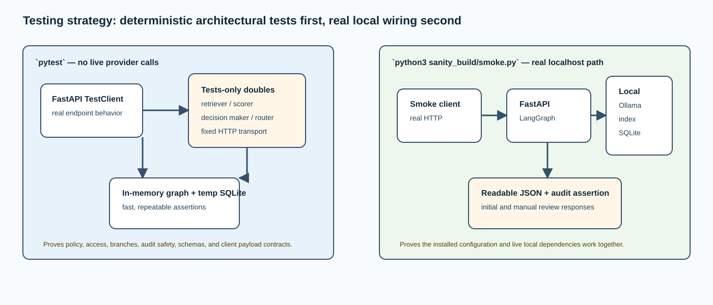

# `tests/` — behavioral evidence without live provider dependencies

## Purpose

The test suite verifies the architectural promises quickly and deterministically.
Real Ollama, real external routing, and real network calls are not used in unit
tests. Instead, each replacement is explicitly named as a **test double** and
lives only under `tests/`, keeping production code free of hidden mocks.

## Test map

| File | Behavior proved | Test isolation technique |
| --- | --- | --- |
| `conftest.py` | Reusable application fixture, graph wiring, approved-router capture | Test-double retriever, scorer, decision maker, router, temporary SQLite |
| `test_api.py` | Two-request review flow, PII absence from audit, rejection does not route, identity/admin rules | FastAPI `TestClient` and injected services |
| `test_ollama_clients.py` | Native Ollama endpoint/payload/schema behavior and local routing | Monkeypatched `httpx.post` test doubles |
| `test_rag_service.py` | RAG health, request contract, subgraph execution, and typed evidence response | FastAPI `TestClient` with an injected RAG retriever test double |
| `test_policy.py` | Redaction before safe state and sensitive-action review | Pure in-process policy test |
| `test_retrieval.py` | Role filtering plus hybrid rank | Fixed-vector embedding test double |
| `test_smoke.py` | Smoke client invokes health/start/review/audit in the expected order | `httpx.MockTransport` test double |

## Shared fixture design

`conftest.py` injects an `InMemorySaver`, temporary SQLite audit URL, local
settings, and deterministic service implementations into `create_app()`. The
test scorer returns a clearly labeled existing-model-style result and the test
decision maker returns a cited referral. The router records case IDs only when
the workflow takes the approve branch. This makes each assertion about the
system’s own state machine, not variability from a model.

## Key architectural assertions

- The PII test confirms known email/phone values are absent from the safe
  narrative and therefore from the audited flow.
- The retrieval test confirms authorization filters chunks *before* ranking.
- The API approval test confirms the graph pauses first, resumes, routes only
  after approval, records evaluation metrics, and does not persist source PII.
- The rejection test confirms no router call happens after a negative review.
- The identity test confirms body claims cannot impersonate an authenticated
  local user and aggregate metrics need the admin role.
- Ollama adapter tests confirm direct native `/api/embed` and `/api/chat` usage,
  typed structured output, the parent-to-RAG HTTP contract, and the local-only
  router semantics.
- The RAG-service test confirms the independently compiled `RagState` graph
  returns evidence without sharing `DecisionState`.

## What tests do not prove

They do not prove Ollama model quality, actual embedding quality, provider
availability, real OIDC/JWKS behavior, PostgreSQL compatibility, or the
security of network deployment. Those are integration, evaluation, and
environment-specific concerns. The smoke command fills part of the gap for the
local runtime, while a production project needs additional integration and
acceptance testing.

## How to run and interpret

Run `ruff check src scripts sanity_build tests`, `python3 -m compileall -q src scripts sanity_build tests`, and `pytest`.
The expected test suite uses no live network dependency. After those pass, start
Ollama, `ai-architect-rag`, and `ai-architect`, then run the smoke test to
validate the real local path.
