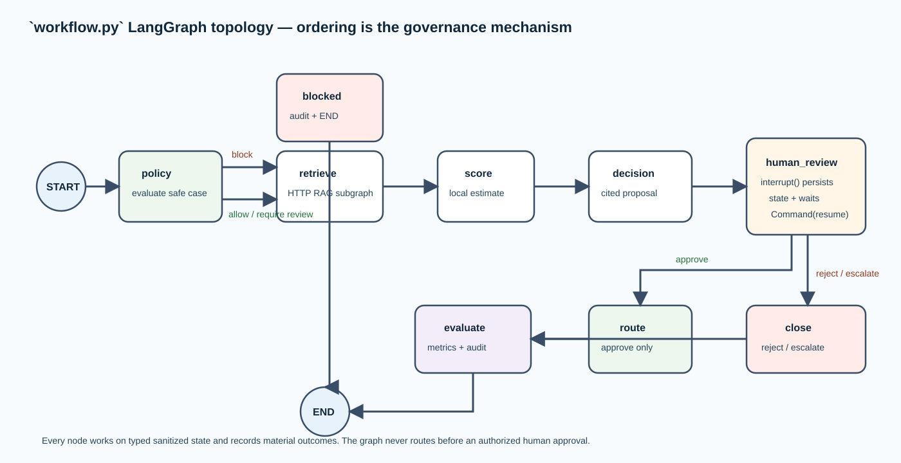

# `workflow.py` — LangGraph decision orchestration and human interrupt

## This is where LangGraph is used

`src/ai_architect/decision/workflow.py` is the direct LangGraph implementation. It
imports `StateGraph`, `START`, `END`, and `interrupt` and compiles a graph with a
checkpointer supplied by `api.py`. There is no LangChain chain in this project.
LangGraph is used because it gives the multi-step decision a named state machine,
durable checkpoint semantics, and a first-class human pause/resume boundary.

## State model

`DecisionState` is a typed dictionary whose fields are serializable
representations of the sanitized submission, policy, evidence, score, proposal,
human review, routing, evaluation, and status. The graph reconstructs Pydantic
models when it needs to work with a field; this prevents loose dictionary data
from drifting across node boundaries.

The state is tied to `thread_id`. In memory mode it survives only while the
process remains alive. With the optional PostgreSQL checkpointer it can be
persisted durably. It is an execution record, not the primary system of record
for insurance customers.

## Node-by-node behavior

| Node | Reads | Produces | Side effect |
| --- | --- | --- | --- |
| `policy` | Safe submission | `PolicyResult` | `policy_evaluated` audit event |
| `blocked` | Safe submission + policy | `status = blocked` | `case_blocked` audit event |
| `retrieve` | Product, narrative, roles | Typed evidence list | Calls remote RAG, then emits `evidence_retrieved` |
| `score` | Safe submission | `RiskScore` | `ml_score_received` audit event |
| `decision` | Safe submission, score, evidence | `DecisionProposal` | `decision_proposed` audit event |
| `human_review` | Proposal, score, evidence | Review after resume | `human_review_recorded` audit event |
| `route` | Approved review + proposal | Routing result | `case_recorded_locally` or `case_routed` audit event |
| `close` | Rejected/escalated review | Closure routing result | `case_rejected` or `case_escalated` audit event |
| `evaluate` | Policy, proposal, evidence | Evaluation + completed status | Metric rows and `decision_evaluated` audit event |

## The graph topology

The normal path is:

`START → policy → retrieve → score → decision → human_review → route/close → evaluate → END`

The `retrieve` node is local from the parent graph's point of view: it owns the
update to `DecisionState.evidence` and the audit event. Its injected
`EvidenceRetriever` is `RemoteRagRetriever`, so the node synchronously calls a
separate port-8081 FastAPI service. That service runs a second isolated graph
whose `retrieval_subgraph` node contains `START → retrieve → END`, then returns
only typed evidence. The two services do not share a state dictionary or a
checkpointer. See
[rag/service.py](rag-service.md) for the boundary and flow diagram.

After `policy`, a conditional edge sends a `block` disposition straight to the
`blocked` terminal node. After `human_review`, approval selects `route`; reject
and escalation select `close`. Both branches meet at `evaluate` so every
reviewed decision receives the same deterministic post-checks.

## The human-in-the-loop mechanism

`human_review` creates `HumanReviewRequest` and calls LangGraph `interrupt()`.
The interrupt value is structured: case ID, tenant, requested action, proposal,
risk score, and evidence. LangGraph checkpoints the state and returns control to
the API rather than holding the HTTP request open.

`api.py` recognizes the interrupt and returns `awaiting_human`. A later
authorized review request calls `Command(resume=<HumanReview>)` with the same
thread ID. Execution resumes on the line after `interrupt()`, validates the
review, audits it, and follows the conditional review edge. This is exactly why
the caller must retain the original thread ID.

## Why the graph is a governance control

The graph places hard ordering around side effects. A score cannot be requested
until policy and authorized retrieval complete. A proposal cannot exist without
evidence. Routing cannot run without an `approve` review. Evaluation runs after
the terminal decision action/closure. This makes the intended pattern reviewable
as a topology, not merely implied by prompt text or an informal sequence.

## Error and safety behavior

Empty authorized evidence causes a visible error rather than a proposal without
support. The unavailable RAG service or Ollama embedding endpoint returns a
visible dependency error rather than a guess. Integration errors are not caught
inside nodes and replaced with a guess; they return through the API as service
errors. The only routing status in local development is a local record. A
rejected or escalated review never calls the router.

## Extending the graph safely

Add a node only with an explicit state input/output, audit event if materially
relevant, and a defined edge order. A new model call should take a sanitized,
typed input and return a validated output. A new action should be downstream of
authorization and human review. If a node can fail due to unavailable external
state, make its failure behavior explicit rather than defaulting to success.

## Validation evidence

The API tests drive the graph through the pause, approval, rejection, audit, and
metrics paths. The smoke test drives the same two-request lifecycle against the
running localhost service. The diagram above is a direct representation of the
nodes and conditional edges defined in this file.
