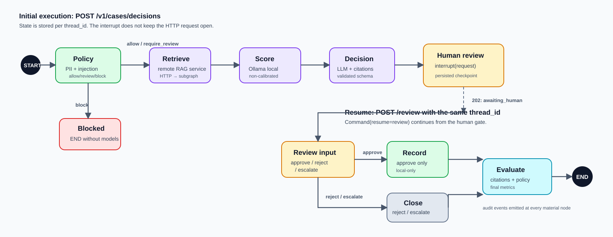

# Decision lifecycle



## Summary

A decision is a durable execution identified by `thread_id`. It starts with `POST /v1/cases/decisions`, deliberately stops at human review, and ends after an approved referral or a closure without external action.

The pause is not an HTTP wait: LangGraph persists state in the checkpointer and the API returns a review request. An authorized person later resumes that exact execution through the review endpoint.

## Start: creating an execution

The start request must contain a valid `CaseSubmission` and authenticated identity. Before LangGraph starts, the API:

1. Reads development identity headers, or verifies an OIDC JWT outside local environments.
2. Checks that body `actor_id`, `tenant_id`, and roles match the principal. An `ai_admin` is the sole exception.
3. Sanitizes the submission and records `case_received` without original PII fields.
4. Assigns a `thread_id` and runs the graph until it reaches an end or an interrupt.

The initial response has one of these meanings:

| Response status | Meaning for the client | Next action |
| --- | --- | --- |
| `awaiting_human` | The graph reached the human gate and is persisted | Show `review_request` to an authorized reviewer |
| `blocked` | Policy blocked the execution | Show its reasons; do not attempt routing |
| `completed` | The flow reached an end without further input | Read the proposal, evaluation, and routing result if present |

The implemented flow normally requires review, but preserves the `blocked` branch for policy rules that must stop a case completely.

## Graph nodes

| Node | What it does | State it stores | Audit event |
| --- | --- | --- | --- |
| `policy` | Analyzes injection, PII redaction, and risk/action rules | `policy` and sanitized case | Policy result |
| `retrieve` | Calls RAG service; its subgraph does BM25 + vector search after role filtering | `evidence` | Chunks and scores |
| `score` | Calls Ollama for a non-calibrated local risk estimate | `score` | Ollama model, local-development version, score, and factors |
| `decision` | Builds the native-Ollama proposal and validates it against evidence | `proposal` | Recommendation, citations, and confidence |
| `human_review` | Creates a review request and interrupts the graph | `human_review` after resume | Review request and outcome |
| `route` | Records an approved case locally in development | `routing` | Local-only routing result |
| `close` | Closes a rejected or escalated decision without calling the router | `routing` with closure status | Closure without action |
| `evaluate` | Evaluates groundedness, policy compliance, and consistency | `evaluation` | Result and metrics |

## Branching rules

## Distributed retrieval step

The parent `retrieve` node is where the distributed boundary is crossed. It
sends a minimized sanitized query and actor roles to port `8081`. The RAG
service runs a separate `RagState` graph whose `retrieval_subgraph` contains
`START → retrieve → END`, then returns validated evidence. The parent records
that evidence in its own `DecisionState`; the remote service cannot mutate
parent state or decide a case.

The parent `thread_id` becomes a correlation value only. The RAG service creates
an independent `rag-{request_id}` checkpoint, which is useful when examining the
subgraph but never replaces the decision thread used for human review.

### Policy

The policy result chooses the first branch:

- `block` → the graph ends. There is no retrieval, ML, LLM, or external action.
- `allow` or `require_review` → the graph continues to retrieval. The `require_review` signal remains available as governance context for the rest of the flow.

Current rules require review for injection signals, exposure equal to or above 5,000,000, and requested `bind` or `pay_claim` actions.

### Human review

The interrupt gives the client a structure containing the case, proposal, score, relevant evidence, and policy reasons. The resume API validates:

1. That the `thread_id` exists and belongs to the supplied `case_id`.
2. That the reviewer belongs to the same tenant, except for administrators.
3. That an `approve` reviewer has `underwriter`, `claims_adjuster`, or `ai_admin`.
4. That `reviewer_id` matches the authenticated identity, except for administrators.

After `Command(resume={"review": ...})`, the outcomes are:

| Human outcome | Branch | External action |
| --- | --- | --- |
| `approve` | `route` → `evaluate` | A local-only record is created; no HTTP call is made |
| `reject` | `close` → `evaluate` | No |
| `escalate` | `close` → `evaluate` | No |

Approval does not turn the LLM into the decision maker: it only unlocks a referral already reviewed by a permitted identity.

## Two-request transition

### 1. Start

```text
POST /v1/cases/decisions
  └─ policy → retrieve → [HTTP → RAG subgraph] → score → decision → interrupt

202: { thread_id, status: "awaiting_human", review_request }
```

The client retains `case_id` and `thread_id`; the latter identifies the graph checkpoint and must not be regenerated during review.

### 2. Resume

```text
POST /v1/cases/{case_id}/decisions/{thread_id}/review
  └─ Command(resume=review) → route or close → evaluate → END

200: { status, proposal, routing, evaluation }
```

In development the router is local-only, so approval does not depend on another service. A future non-development router must return an integration error rather than falsely report a case as routed.

## Persisted state and provenance

The state is not intended to be the system of record for business cases; it is the operational record of a decision execution. It holds:

- Thread identifier and sanitized case.
- Policy result.
- Evidence with version and `chunk_id`, returned by the separate RAG subgraph.
- Local Ollama estimate with model name and local-development version.
- Ollama proposal with citations.
- Human review and routing result when present.
- Final evaluation and execution status.

Using the same state for explanation and resume prevents a decision from being made on evidence other than what the reviewer saw.

## Terminal states

| Situation | Expected `status` | `routing.status` | Meaning |
| --- | --- | --- | --- |
| Policy blocks | `blocked` | Absent | The case did not process models or actions |
| Review approves locally | `completed` | `recorded` | A local-only approval record was audited; no external referral exists |
| Review rejects | `completed` | `rejected` | The case closes without the router |
| Review escalates | `completed` | `escalated` | The case needs handling outside this flow |

## End-of-flow evaluation

Current evaluation is deterministic and answers three questions:

1. **Groundedness:** do all proposal citations belong to the retrieved chunks?
2. **Policy compliance:** was the proposal emitted in an execution that was not blocked?
3. **Referral consistency:** if the recommendation is `refer`, does it include an escalation reason?

The result aggregates failure reasons, a final boolean, and indicators that feed the metrics table. This evaluation does not replace human control; it measures the flow and helps detect degradation.

## How to investigate a case

1. Use `GET /v1/audit/{thread_id}` with an identity from the case tenant, or an administrator.
2. Order events by sequence to see the last completed node.
3. Compare proposal citations with evidence `chunk_id` values.
4. Check the index version, Ollama model name, local-development score label, and evaluation result.
5. In local mode, confirm that routing is `recorded` with destination `local-only`; there is no receiving system to reconcile.

The API does not allow the audit endpoint to enumerate other-tenant cases: it first verifies that state exists for the thread and then applies the tenant restriction.
