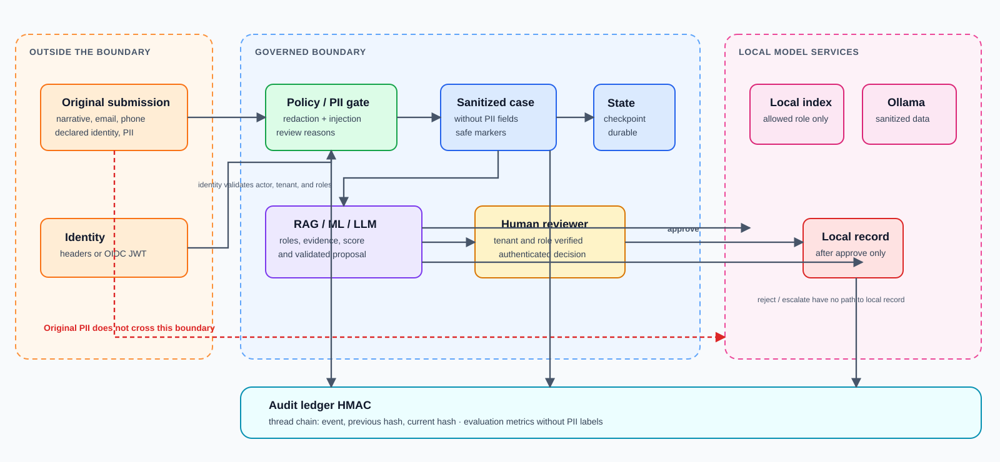

# Security and governance

## Security model

The system treats user inputs and provider responses as untrusted. Controls do not depend on a prompt behaving well: identity, retrieval filtering, contract validation, approval gates, and auditing are separate layers.

## Data classification and path

| Data | Where it can enter | Treatment | Where it can go |
| --- | --- | --- | --- |
| Case narrative | Authenticated public API | Checked for PII and injection; redacted | Parent state/audit and, as a minimized query, the separate RAG service; Ollama only sees sanitized form |
| Email, phone, and customer reference | Optional submission fields | Excluded from `SanitizedSubmission` | Must not enter checkpoints or normal-flow integrations |
| IBAN inside narrative | Free text | Replaced with a marker | Only the marker travels downstream |
| Identity and roles | Local headers or JWT claims | Validated; never decided by the LLM | Endpoint authorization and access filters |
| Policy evidence | JSONL index owned by port-8081 RAG service | Filtered by `allowed_roles` before the LLM | Typed evidence returns to parent proposal, review, and audit |
| Score and factors | Ollama | Structure and local-development provenance validation | Proposal, review, audit, and metrics |
| Human decision | Review endpoint | Reviewer and tenant validation | Routing/closure branch and audit |

## Policy and PII gate

The gate is the first domain layer and runs before the graph is created or invoked. It performs three jobs:

1. **Known-PII redaction.** It detects email, phone, and IBAN patterns inside the narrative and replaces them with markers. It also excludes direct email, phone, and customer-reference fields. It records the number of redactions without keeping the original value.
2. **Injection detection.** It looks for signals such as instructions to ignore previous instructions, reveal prompts, or adopt a system/developer role.
3. **Review policy.** It marks review as mandatory for detected injection, exposure of at least 5 million, or sensitive bind/payment actions.

Pattern-based detection is not a universal guarantee for PII or injection. It is a concrete, testable barrier; if the domain handles other PII types, rules must be extended, tested against representative corpora, and supplemented with specialized DLP before production.

## Identity by environment

| Environment | Mechanism | Purpose |
| --- | --- | --- |
| Development | `X-Development-Actor-ID`, `X-Development-Tenant-ID`, and `X-Development-Roles` | Unauthenticated local learning mode |
| Staging/production | Bearer JWT, JWKS, OIDC issuer, and audience | Verifiable identity and key rotation |

In staging and production, configuration requires OIDC and does not enable development headers. The JWT must have `sub`, `tenant_id`, and a list of `roles`; signature, issuer, and audience are verified with RS256 or ES256.

## Authorization matrix

| Operation | Requirement |
| --- | --- |
| Create a decision | Valid principal; body consistent with the principal's actor, tenant, and roles |
| Read thread audit | Same tenant as the case or `ai_admin` |
| Submit a `reject` or `escalate` review | Same tenant and reviewer consistent with the principal |
| Submit an `approve` review | The preceding requirements, plus `underwriter`, `claims_adjuster`, or `ai_admin` role |
| Read aggregate metrics | `ai_admin` only |
| Bypass actor/body consistency checks | `ai_admin` only |

Retrieval roles and approval roles are distinct controls. Permission to read an internal guide does not grant approval authority, and vice versa.

## Prompt-injection defense

Gate detection is only the first line. The design adds:

- The LLM receives a role instruction limiting it to proposals, not actions.
- Evidence is assembled from authorized retrieval results, not from prompt requests.
- The remote RAG request has a Pydantic schema and contains no parent state or
  human-review authority.
- The proposal is validated against a JSON schema and the `chunk_id` values actually retrieved.
- External action depends on authenticated human review, not model-generated text.
- Policy retains the injection signal so the reviewer can assess the risk.

As a result, even if a narrative attempts to influence the model, it cannot change credentials, disclose documents that the retriever withheld, or invoke the router on its own.

## HMAC-chained audit

Each `thread_id` event is stored as an append-only entry with:

- Identifier and timestamp.
- Event type.
- Sanitized JSON payload.
- Previous event hash for the same thread.
- Current HMAC-SHA256 event hash.

The current hash is calculated from the previous hash and a canonical event representation. Changing or reordering an event breaks following hashes in the thread, making tampering detectable when the HMAC key is retained and the chain is verified.

The chain does not replace database protection: `AUDIT_HMAC_KEY` must live in a secrets manager, be rotated through a controlled procedure, and never appear in logs, repositories, or container images.

## Audit versus observability

Audit answers “what happened in this case and with what evidence.” Metrics answer “how is the system behaving overall.” The sources share events but have different access and retention concerns:

- The audit endpoint is tenant-limited to protect case details.
- Metrics are aggregated and require `ai_admin`.
- Sensitive data must not be used as metric labels or trace attributes.

## Local approval record

The local recorder receives the proposal and approved review from the `route` node. This node is unreachable from a `reject` or `escalate` review, or from a blocked case. In development it returns `recorded` with destination `local-only` and makes no HTTP call. That separation is stronger than asking the LLM “not to act”: the program path does not exist for the other branches.

Before enabling a real action outside development, the receiver should use service authentication, TLS, explicit timeouts, idempotency based on `case_id`/correlation ID, and receipt logging. The optional external contract supports a URL and API key, but the end-to-end guarantee also depends on the receiving system.

## Boundaries and operational decisions

- Redaction is pattern-based, so it must be reviewed when languages, formats, or PII fields change.
- The ledger blocks known top-level PII values; every new audit payload needs a targeted review to avoid adding nested PII.
- Access to the local JSONL index is governed by the application; a remote store must reproduce tenant/role filtering at the data service.
- The local RAG service is a separate process, not an authorization service. Its
  port must remain loopback-only in learning mode; production needs mTLS or
  service authentication, authorization enforcement, and request tracing.
- LangGraph memory is suitable only for development. Resume after restart requires PostgreSQL.
- The local Ollama estimate is intentionally marked non-calibrated. It must not be treated as a production risk model.
